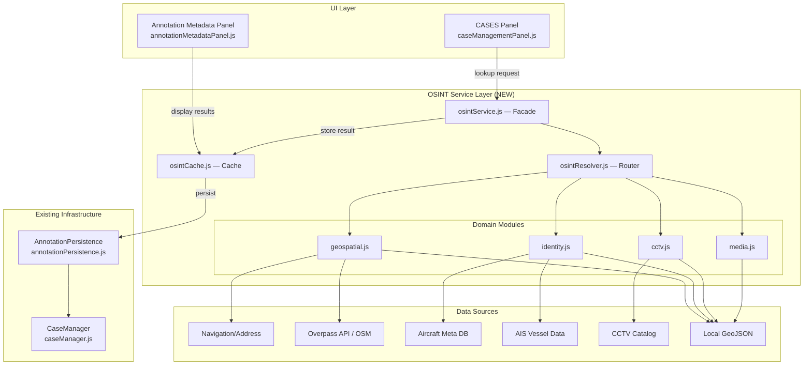

# OSINT Correlation Suite — Architecture Plan

## 1. Executive Summary

This plan extends the existing CASES panel infrastructure with a comprehensive OSINT (Open Source Intelligence) correlation layer. The CASES panel already handles case CRUD, annotation linkage, and localStorage persistence. **The gap is purely in the OSINT lookup/correlation layer** — connecting case annotations to external data sources and local GeoJSON datasets.

## 2. Current State Assessment

### What Already Exists

| Component | Status | File |
|-----------|--------|------|
| Case CRUD + persistence | Complete | [`caseManager.js`](src/investigation/caseManager.js) |
| Annotation-to-case linkage | Complete | [`annotationPersistence.js`](src/investigation/annotationPersistence.js) |
| OSINT annotation type | Defined | [`types.js`](src/investigation/types.js:OSINTAnnotationExtension) |
| CASES panel UI | Complete | [`caseManagementPanel.js`](src/ui/caseManagementPanel.js) |
| Metadata editing panel | Complete | [`annotationMetadataPanel.js`](src/ui/annotationMetadataPanel.js) |
| Aircraft contact matching | Complete | [`contactMatch.js`](src/data/contactMatch.js) |
| Aircraft metadata lookup | Complete | [`aircraftMeta.js`](src/data/aircraftMeta.js) |
| CCTV camera catalog | Complete | [`cctv*.js`](src/data/cctv*.js) modules |
| Overpass API queries | Partial | Used in annotation resolver |
| Reverse geocode chain | Complete | Nominatim → Photon fallback |
| Local GeoJSON datasets | Complete | dams, datacenters, cables, neighborhoods, natural earth |

### What Is Missing

The OSINT suite needs a **unified service layer** that:
1. Exposes a facade for triggering lookups from the CASES panel
2. Routes queries to the correct domain resolver (geospatial, identity, CCTV)
3. Caches results to avoid redundant API calls
4. Stores results back through the existing annotation extension pipeline

## 3. Architecture Overview

### Directory Structure

```
src/investigation/
├── osintService.js          # Unified OSINT facade
├── osintResolver.js         # Multi-source resolver with fallback chains
├── osintTypes.js            # OSINT-specific type definitions
├── osintCache.js            # In-memory + localStorage cache
└── osint/                   # Domain-specific modules
    ├── geospatial.js        # Reverse geocode, Overpass, place lookup
    ├── identity.js          # Aircraft, vessel, plate lookups
    ├── cctv.js              # CCTV camera discovery
    └── media.js             # Satellite imagery, enrichment utilities
```

### Component Diagram



### Data Flow

```
User clicks "Correlate OSINT" on annotation in CASES panel
    ↓
caseManagementPanel.js calls osintService.lookup(annotationId, type, params)
    ↓
osintService routes to osintResolver.resolve(type, params)
    ↓
osintResolver checks osintCache first (cache hit → return immediately)
    ↓
Cache miss → dispatch to domain module:
    ├── geospatial → reverseGeocode(coords) + overpassQuery(bbox) + geojsonIntersect(coords)
    ├── identity → aircraftMeta.lookup(registration) + contactMatch.rankContactMatch(subject)
    └── cctv → cctvCatalog.findNearby(coords)
    ↓
Result stored in osintCache, then persisted via AnnotationPersistence
    ↓
CASES panel refreshes to show correlation count
Annotation Metadata Panel shows expanded OSINT results section
```

## 4. Type Definitions

### New Types (in `osintTypes.js`)

```javascript
// Lookup request from UI
/** @typedef {Object} OsintLookupRequest */
/** @property {string} annotationId */
/** @property {'geospatial' | 'identity' | 'cctv' | 'media' | 'all'} type */
/** @property {number[]} [coordinates] — [lat, lon] */
/** @property {number[]} [bbox] — [minLat, minLon, maxLat, maxLon] */
/** @property {string} [registration] — aircraft registration */
/** @property {string} [callsign] — aircraft callsign */
/** @property {string} [mmsi] — vessel MMSI */
/** @property {string} [plate] — license plate */

// Lookup result envelope
/** @typedef {Object} OsintResult */
/** @property {string} annotationId */
/** @property {'geospatial' | 'identity' | 'cctv' | 'media'} source */
/** @property {string} timestamp */
/** @property {any} data — Domain-specific payload */
/** @property {number} latencyMs */

// Cache entry
/** @typedef {Object} OsintCacheEntry */
/** @property {string} annotationId */
/** @property {string} source */
/** @property {string} cacheKey — Hashed query params */
/** @property {OsintResult} result */
/** @property {number} expiresAt */
```

### Extension of Existing Types

The existing [`OSINTAnnotationExtension`](src/investigation/types.js) type already supports OSINT results via its flexible `metadata: Record<string, any>` field:

```javascript
// Current definition (no changes needed):
/** @typedef {Object} OSINTAnnotationExtension */
/** @property {string} caseId */
/** @property {'manual' | 'voice' | 'import'} source */
/** @property {OSINTMetadata} [metadata] */
/** @property {boolean} isPersistent */

// OSINT service will populate metadata as:
// metadata.osint = {
//   geospatial: [{ address, placeType, osmId }],
//   identity: [{ type: 'aircraft', registration, model, owner }],
//   cctv: [{ cameraId, name, distanceMeters, streamUrl }]
// }
```

## 5. Module Specifications

### 5.1 `osintService.js` — Facade

**Responsibility**: Single entry point for UI components to trigger OSINT lookups.

**API**:
```javascript
export class OsintService {
  // Trigger a lookup; returns Promise<OsintResult[]>
  async lookup(request)
  
  // Get cached results for an annotation
  getResults(annotationId)
  
  // Clear all cached results
  clearCache()
  
  // Check if OSINT is available (network + API health)
  static isAvailable(): boolean
}
```

**Design**: Thin wrapper that delegates to `osintResolver` and `osintCache`. No domain logic.

### 5.2 `osintResolver.js` — Router

**Responsibility**: Route lookup requests to the correct domain module with fallback chains.

**API**:
```javascript
export class OsintResolver {
  // Resolve a single-domain lookup
  async resolve(type, params)
  
  // Resolve all domains for an annotation
  async resolveAll(annotationId, coordinates)
}
```

**Fallback Chains**:
- **Geospatial**: Nominatim → Photon (keyless) → local Geojson intersect
- **Identity**: aircraftMeta (local DB) → contactMatch (live subject) → fallback to null
- **CCTV**: cctvCatalog.findNearby() → local footprint match → empty

### 5.3 `osintCache.js` — Cache

**Responsibility**: In-memory cache with TTL, backed by localStorage for persistence across reloads.

**API**:
```javascript
export class OsintCache {
  // Store a result (default TTL: 1 hour)
  store(annotationId, source, result, ttlMs = 3600000)
  
  // Get cached result
  get(annotationId, source)
  
  // Check if entry is still valid
  isValid(entry): boolean
  
  // Clear all entries
  clear()
  
  // Remove entries for an annotation
  remove(annotationId)
}
```

**Storage key**: `gev_osint_cache` in localStorage.

### 5.4 `osint/geospatial.js` — Geospatial Module

**Responsibility**: Reverse geocode, Overpass API queries, local GeoJSON intersection.

**API**:
```javascript
export class OsintGeospatial {
  // Reverse geocode coordinates to address/place
  async reverseGeocode(coordinates)
  
  // Query Overpass API for OSM features in bbox
  async overpassQuery(bbox, tags)
  
  // Intersect coordinates with local GeoJSON layers
  intersectGeojson(coordinates, layers)
  
  // Get place footprint (city, region, country)
  getPlaceFootprint(coordinates)
}
```

**Data sources**:
- Nominatim API (https://nominatim.openstreetmap.org/reverse)
- Photon API (https://photon.komoot.io/api)
- Local GeoJSON: dams, datacenters, submarine cables, neighborhoods, natural earth regions

### 5.5 `osint/identity.js` — Identity Module

**Responsibility**: Aircraft registration/callsign lookup, vessel MMSI search, license plate matching.

**API**:
```javascript
export class OsintIdentity {
  // Lookup aircraft by registration
  async lookupAircraft(registration)
  
  // Match callsign against live traffic subjects
  matchCallsign(callsign)
  
  // Lookup vessel by MMSI
  async lookupVessel(mmsi)
  
  // Match license plate against known contacts
  matchPlate(plate)
  
  // Run all identity checks on a contact subject
  correlateSubject(subject)
}
```

**Data sources**:
- `aircraftMeta.js` — Local aircraft registry (registration → model, owner, type)
- `contactMatch.js` — Live traffic subject matching (rankContactMatch)
- AIS stream data — Vessel MMSI lookup
- Contact playback — License plate history

### 5.6 `osint/cctv.js` — CCTV Module

**Responsibility**: Discover nearby CCTV cameras, retrieve metadata and stream info.

**API**:
```javascript
export class OsintCCTV {
  // Find cameras within radius of coordinates
  async findNearby(coordinates, radiusMeters = 500)
  
  // Get camera details by ID
  getCamera(cameraId)
  
  // Get camera stream URL (if available)
  getStreamUrl(cameraId)
  
  // Correlate all nearby cameras for an annotation
  correlateNearby(annotationId, coordinates)
}
```

**Data sources**:
- `cctvCards.js` — CCTV card metadata
- `cctvCatalogCap.test.mjs` — Catalog capacity info
- `cctvFootprint.js` — Camera coverage footprint
- Estonia/Texas/Fintraffic/NSW source adapters

### 5.7 `osint/media.js` — Media Module

**Responsibility**: Satellite imagery dates, enrichment utilities.

**API**:
```javascript
export class OsintMedia {
  // Get satellite pass times for coordinates
  async getSatellitePasses(coordinates, dateRange)
  
  // Get local GeoJSON layer timestamps
  getLayerTimestamps(layerName)
  
  // Enrich annotation with media metadata
  enrich(annotationId, data)
}
```

**Data sources**:
- Sentinel Hub API (configurable, optional)
- NASA Earthdata API (configurable, optional)
- Local GeoJSON date metadata (always available)

## 6. UI Integration Plan

### 6.1 CASES Panel Changes (`caseManagementPanel.js`)

**Additions**:
1. "Correlate OSINT" button per annotation in the case detail view
2. OSINT result count badge next to annotation
3. "Correlate All" button for bulk operation on case annotations

**Code changes**:
```javascript
// In _render() or annotation list rendering:
const correlateBtn = document.createElement('button');
correlateBtn.className = 'osint-correlate-btn';
correlateBtn.textContent = '🔍 Correlate OSINT';
correlateBtn.addEventListener('click', () => {
  this.onOsintCorrelate(annotationId, coords);
});

// In onOsintCorrelate handler:
async onOsintCorrelate(annotationId, coordinates) {
  const results = await this.osintService.lookup({
    annotationId,
    type: 'geospatial',
    coordinates,
  });
  // Trigger UI refresh to show results
  this.onCaseSelected(this.activeCase);
}
```

### 6.2 Annotation Metadata Panel Changes (`annotationMetadataPanel.js`)

**Additions**:
1. New "OSINT Results" collapsible section below metadata fields
2. Per-source result cards (expandable) showing correlation data
3. "Refresh" button to re-run lookups

**Layout**:
```
┌─ Annotation Metadata ────────────────┐
│ Label: [________]                     │
│ Source: [manual ▼]                    │
│ Case:  [________]                     │
│                                       │
│ ┌─ OSINT Results (3 sources) ─────┐ │
│ │ [+] Geospatial (2 results)      │ │
│ │ [+] Identity (1 result)         │ │
│ │ [x] CCTV (0 results)            │ │
│ └─────────────────────────────────┘ │
│                                       │
│ [Save] [Cancel]                     │
└───────────────────────────────────────┘
```

**Result card format**:
```html
<div class="osint-result-card">
  <div class="osint-result-header">Geospatial</div>
  <div class="osint-result-body">
    <div class="osint-result-item">
      <span class="osint-label">Address:</span>
      <span class="osint-value">123 Main St, City, Country</span>
    </div>
    <div class="osint-result-item">
      <span class="osint-label">Place Type:</span>
      <span class="osint-value">house</span>
    </div>
    <div class="osint-result-item">
      <span class="osint-label">OSM ID:</span>
      <span class="osint-value">way/123456789</span>
    </div>
  </div>
</div>
```

### 6.3 App Tools Wiring (`src/app/tools.js`)

**Additions**:
```javascript
// Create OSINT service singleton
const osintService = new OsintService({
  resolver: new OsintResolver(),
  cache: new OsintCache(),
});

// Pass to CASES panel
caseManagementPresentation.onMount = (panel) => {
  panel.osintService = osintService;
  panel.onOsintCorrelate = async (annotationId, coords) => {
    const results = await osintService.lookup({
      annotationId, type: 'geospatial', coordinates: coords,
    });
    // Trigger refresh
    panel.onCaseSelected(panel.activeCase);
  };
};

// Pass to metadata panel
annotationMetadataPanel.osintService = osintService;
```

## 7. Implementation Phases

### Phase 1: Core Service + Geospatial (Foundation)

**Files created**:
- `src/investigation/osintTypes.js`
- `src/investigation/osintCache.js`
- `src/investigation/osintResolver.js`
- `src/investigation/osintService.js`
- `src/investigation/osint/geospatial.js`

**Files modified**:
- `src/app/tools.js` — Wire up osintService singleton

**Deliverables**:
- OSINT service facade with cache layer
- Reverse geocode (Nominatim → Photon fallback)
- Overpass API query support
- Local GeoJSON intersection (dams, datacenters, cables, neighborhoods)
- Place footprint detection (city/region/country from natural earth)

### Phase 2: Identity Correlation

**Files created**:
- `src/investigation/osint/identity.js`

**Files modified**:
- `src/investigation/osintResolver.js` — Add identity routing
- `src/app/tools.js` — Pass identity data sources to resolver

**Deliverables**:
- Aircraft registration lookup (aircraftMeta DB)
- Callsign matching against live traffic (contactMatch)
- Vessel MMSI lookup (AIS data)
- License plate correlation

### Phase 3: CCTV Camera Discovery

**Files created**:
- `src/investigation/osint/cctv.js`

**Files modified**:
- `src/investigation/osintResolver.js` — Add CCTV routing

**Deliverables**:
- Nearby camera discovery (radius-based)
- Camera metadata retrieval
- Stream URL resolution

### Phase 4: UI Integration

**Files modified**:
- `src/ui/caseManagementPanel.js` — Add "Correlate OSINT" button + handler
- `src/ui/annotationMetadataPanel.js` — Add OSINT results section
- `src/app/tools.js` — Wire up handlers

**Deliverables**:
- CASES panel shows OSINT correlation button per annotation
- Annotation metadata panel displays OSINT results
- Result count badge on annotations with correlations

### Phase 5: Polish + Media Module

**Files created**:
- `src/investigation/osint/media.js`

**Files modified**:
- `src/investigation/osintResolver.js` — Add media routing
- CSS styles for OSINT result cards

**Deliverables**:
- Satellite imagery date lookup (Sentinel Hub / local GeoJSON)
- Styling for OSINT result cards in annotation metadata panel
- Error handling and loading states

## 8. Error Handling Strategy

| Scenario | Behavior |
|----------|----------|
| Network unavailable | Cache miss → return empty results; show "Offline" badge |
| API rate limit | Exponential backoff retry (3 attempts); fall through to next source |
| Partial failure (some sources fail) | Return partial results from successful sources; log errors |
| Invalid coordinates | Return early with error result; no API calls made |
| Stale cache entry | Discard and re-fetch; log warning |

## 9. Performance Considerations

1. **Cache TTL**: Default 1 hour for geospatial results; 24 hours for identity lookups (static data)
2. **Debouncing**: Geospatial lookups debounced at 300ms to avoid redundant calls during drag/pan
3. **Batch queries**: Overpass API supports multi-tag queries in a single request
4. **Local-first**: All local GeoJSON lookups execute synchronously (no network)
5. **Lazy loading**: OSINT modules loaded on demand via dynamic import (code splitting)

## 10. Testing Strategy

| Module | Test Type | Coverage |
|--------|-----------|----------|
| `osintCache.js` | Unit | Store/get/expire/clear operations |
| `osint/geospatial.js` | Unit + Mock | Reverse geocode, Overpass, GeoJSON intersect |
| `osint/identity.js` | Unit + Mock | Aircraft lookup, callsign match, MMSI search |
| `osint/cctv.js` | Unit + Mock | Nearby discovery, camera metadata |
| `osintResolver.js` | Integration | Fallback chain behavior |
| `osintService.js` | Integration | Facade routing, cache integration |
| UI components | E2E | Button click → result display |

## 11. Configuration

OSINT service accepts a configuration object at construction:

```javascript
const osintService = new OsintService({
  resolver: new OsintResolver({
    geospatial: {
      nominatimUrl: 'https://nominatim.openstreetmap.org/reverse',
      photonUrl: 'https://photon.komoot.io/api',
      maxRetries: 3,
      timeoutMs: 5000,
    },
    overpass: {
      apiUrl: 'https://overpass-api.de/api/interpreter',
      bboxRadius: 0.01, // degrees for default query
    },
    identity: {
      aircraftDb: aircraftMeta, // injected local DB
      contactMatch: contactMatch, // injected module
    },
    cctv: {
      catalog: cctvCatalog, // injected source
      defaultRadius: 500, // meters
    },
  }),
  cache: new OsintCache({
    defaultTtlMs: 3600000, // 1 hour
    storageKey: 'gev_osint_cache',
  }),
});
```

## 12. Files Summary

### New Files (8)

| File | Purpose |
|------|---------|
| `src/investigation/osintTypes.js` | Type definitions for OSINT results and requests |
| `src/investigation/osintCache.js` | In-memory + localStorage cache with TTL |
| `src/investigation/osintResolver.js` | Multi-source resolver with fallback chains |
| `src/investigation/osintService.js` | Unified facade for UI components |
| `src/investigation/osint/geospatial.js` | Reverse geocode, Overpass, GeoJSON intersection |
| `src/investigation/osint/identity.js` | Aircraft, vessel, plate identity correlation |
| `src/investigation/osint/cctv.js` | CCTV camera discovery and metadata |
| `src/investigation/osint/media.js` | Satellite imagery dates, enrichment |

### Modified Files (4)

| File | Change |
|------|--------|
| `src/ui/caseManagementPanel.js` | Add "Correlate OSINT" button + handler |
| `src/ui/annotationMetadataPanel.js` | Add OSINT results display section |
| `src/app/tools.js` | Wire up osintService singleton, pass to panels |
| `src/ui/styles/scenes.css` (or new file) | CSS for OSINT result cards |

## 13. Open Questions (For User Review)

1. **Rate limiting**: Should the OSINT service implement request throttling/debouncing for external APIs?
2. **Batch correlation**: Should there be a "correlate all annotations in case" batch operation?
3. **Result display**: Collapsible sections per source in annotation metadata panel?
4. **Satellite imagery**: Preferred API (Sentinel Hub, NASA Earthdata) or local GeoJSON only?
